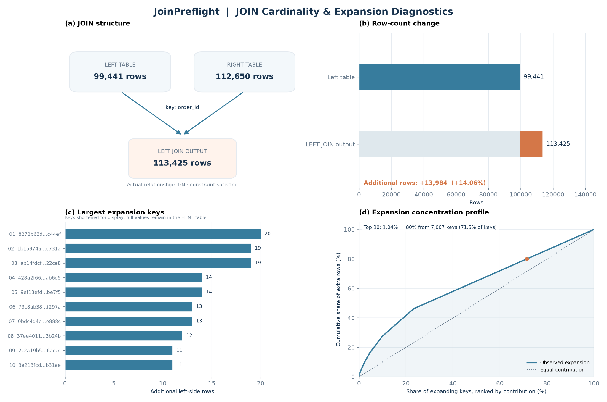
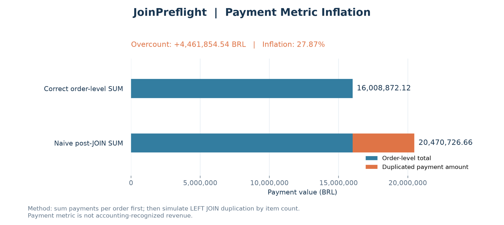
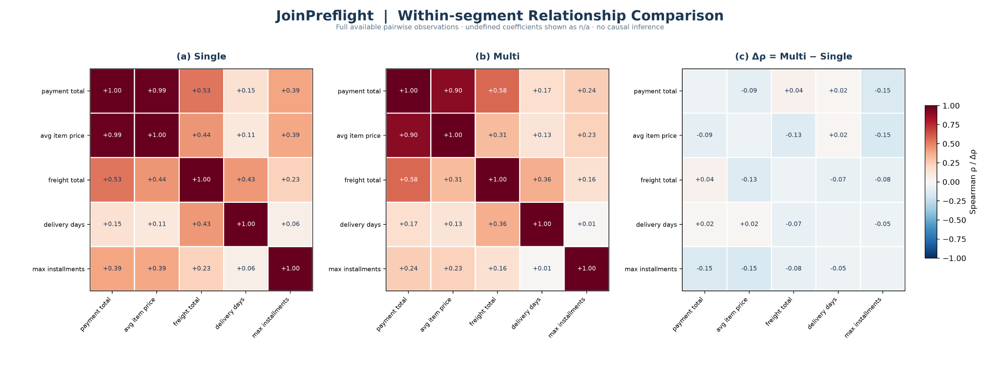
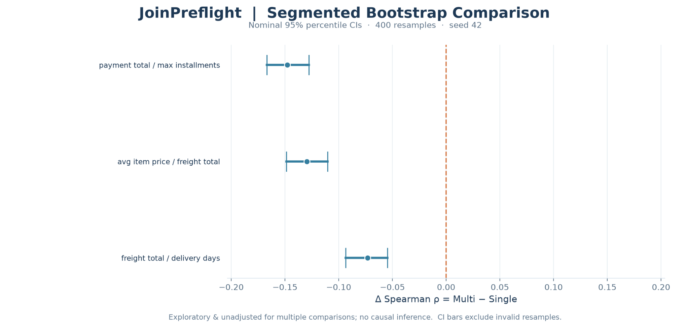

# JoinPreflight

**Inspect JOIN cardinality before you aggregate. Quantify how a valid JOIN can distort business metrics.**

JoinPreflight is an early-stage Python toolkit for CSV JOIN diagnostics, modeled post-JOIN payment overcount, and reproducible exploratory analysis. It offers a command-line interface for core diagnostics and optional Python examples for advanced relationship matrices, segmented analysis, and bootstrap uncertainty estimation.

> **Release candidate — not yet a published package.** This README documents the current development capabilities. Check CI, installation, and release hygiene before tagging a version. The examples model the consequences of an **incorrect aggregation**; they do not assert errors in Olist's original transactions or recognized financial revenue.

## Results at a glance

The figures below were generated using the public [Brazilian E-Commerce Public Dataset by Olist](https://www.kaggle.com/datasets/olistbr/brazilian-ecommerce). They are **not** derived from the small synthetic fixture.

| Diagnostic | Olist result |
|:--|--:|
| Order rows | 99,441 |
| Item rows | 112,650 |
| Expected / actual cardinality | 1:N / 1:N |
| Predicted LEFT JOIN output | 113,425 rows |
| Extra left-side rows | 13,984 (+14.06%) |
| Correct recorded order-level payment SUM | BRL 16,008,872.12 |
| Hypothetical naive JOIN-then-SUM | BRL 20,470,726.66 |
| **Modeled payment overcount** | **BRL 4,461,854.54 (+27.87%)** |

### Cardinality and metric impact





### Advanced exploratory analysis (separate Python scripts)





The bootstrap forest plot uses **400 stratified-by-group, within-group IID resamples** and **nominal 95% percentile intervals** for three **post-selected** correlation pairs. The intervals are exploratory, **not multiplicity-adjusted**, and assume approximately independent orders. They are not causal conclusions or financial risk estimates.

## Why this matters

`orders` has one row per order; `order_items` can contain several rows for the same `order_id`. A perfectly valid 1:N LEFT JOIN can repeat order-level values. Summing order-level payment totals **after** that JOIN can produce an inflated value without any invalid primary key.

JoinPreflight keeps these distinct:

- **Relationship validation:** expected vs observed JOIN cardinality.
- **Size prediction:** expected output rows and duplication hot spots.
- **Metric-grain validation:** correct order-level sum vs a hypothetical naive post-JOIN sum.
- **Exploratory statistics:** feature-selection audit, order-segment correlations and nominal bootstrap intervals.

The project currently targets **single-column LEFT JOINs** in the documented CLI paths. It is not a complete SQL parser, database-integrity checker, or causal-analysis system.

## Install from source

Python 3.10+ is intended; each advertised version must pass remote CI before release.

```bash
python -m venv .venv
python -m pip install -e ".[dev]"
joinpreflight --help
```

Windows PowerShell, without activating the environment:

```powershell
py -m venv .venv
.\.venv\Scripts\python.exe -m pip install -e ".[dev]"
.\.venv\Scripts\joinpreflight.exe --help
```

**Dependencies:** pandas for core tabular logic; matplotlib for plots; SciPy for Spearman correlation paths using pandas. Make sure `pyproject.toml` actually declares all dependencies for the installed extra. Network or wheel-availability issues are environmental and must not be silently bypassed in public CI.

## Quick start (no Olist download)

The repository includes a tiny **synthetic fixture** under `examples/sample_data/` so you can hand-check the results:

```bash
python tools/smoke_demo.py
```

Expected fixture totals: **6 orders**, **7 item rows**, **9 LEFT JOIN output rows**, correct payment **215.00 BRL**, naive SUM **385.00 BRL**, and modeled overcount **170.00 BRL**. The smoke script uses a temporary directory and verifies both metrics and generated report outputs.

To keep a report (PowerShell):

```powershell
.\.venv\Scripts\joinpreflight.exe report `
  --orders examples\sample_data\orders.csv `
  --items examples\sample_data\order_items.csv `
  --payments examples\sample_data\payments.csv `
  --on order_id --value payment_value --expected "1:N" `
  --currency BRL --top 10 `
  --output reports\sample_unified.html
Start-Process .\reports\sample_unified.html
```

Or inspect available CLI commands:

```bash
joinpreflight join --help
joinpreflight impact --help
joinpreflight report --help
```

## Reproduce the Olist diagnostics

Download the public Olist dataset separately and keep it **outside** the repository. On Windows PowerShell:

```powershell
$root = "C:\path\to\olist-data"
$orders = Join-Path $root "olist_orders_dataset.csv"
$items = Join-Path $root "olist_order_items_dataset.csv"
$payments = Join-Path $root "olist_order_payments_dataset.csv"

.\.venv\Scripts\joinpreflight.exe report `
  --orders $orders --items $items --payments $payments `
  --on order_id --value payment_value --expected "1:N" `
  --currency BRL --top 10 --output reports\olist_unified.html
```

The additional analytics presently run via example scripts, **not** as registered CLI subcommands:

```powershell
# Data-driven n x n relationship matrix
.\.venv\Scripts\python.exe examples\09_adaptive_pair_matrix.py $orders $items $payments --max-features 7

# Single-item vs multi-item segment comparison
.\.venv\Scripts\python.exe examples\11_segmented_order_analysis.py $orders $items $payments --output reports\olist_segmented

# Exploratory group-specific bootstrap comparison
.\.venv\Scripts\python.exe examples\13_bootstrap_segmented.py $orders $items $payments --n-boot 400 --seed 42 --output reports\olist_bootstrap
```

Generated reports should be written under `reports/` and excluded from Git by default. Commit curated figures under `docs/assets/`, not raw Olist data.

## Technical method

For each order `i`, let `p_i` be the recorded order-level payment total and `n_i` the associated item-detail row count. A LEFT JOIN retains `m_i = max(n_i, 1)` rows.

```text
Correct payment SUM  = Σ p_i
Naive post-JOIN SUM  = Σ m_i · p_i
Modeled overcount    = Σ (m_i - 1) · p_i
Inflation rate       = 100 · modeled overcount / correct payment SUM
```

Payment rows are aggregated to the order grain before computing the counterfactual. Missing payment records are tracked separately; absent records are not evidence of an actual zero payment. The inflation rate is undefined for a zero correct baseline.

Exploratory analysis uses **Spearman rank correlation**, with auditable feature selection, optional scatter sampling for display, and pairwise non-null observations for each reported correlation. Single vs Multi segmentation uses item-detail counts, with no-item orders reported separately. Bootstrap confidence intervals use order-level resampling within these groups and are subject to IID and post-selection limitations.

## Development and testing

```bash
python -m pytest -q
python tools/smoke_demo.py
python tools/release_preflight.py --json reports/release_preflight.json
python -m build
python -m twine check dist/*
```

The last known checked-in development checkpoint is local Git commit `6244786`; this document does **not** claim that GitHub CI or a public release has passed. Test counts may change as release tests are added.

## Responsible interpretation

A valid 1:N join does not imply metric safety; a modeled overcount is **not** an observed accounting misstatement. Rank correlations are descriptive, not causal. The three bootstrap intervals on the Olist case were selected after inspecting correlations; they are not simultaneous confidence statements or corrected hypothesis tests. Repeated buyers and sellers can invalidate the independent-order sampling approximation.

## Contributing and license

Bug reports, example improvements, regression tests, and documentation updates are welcome. See `CONTRIBUTING.md` for contribution guidance. Please verify the repository's license file before public release.
